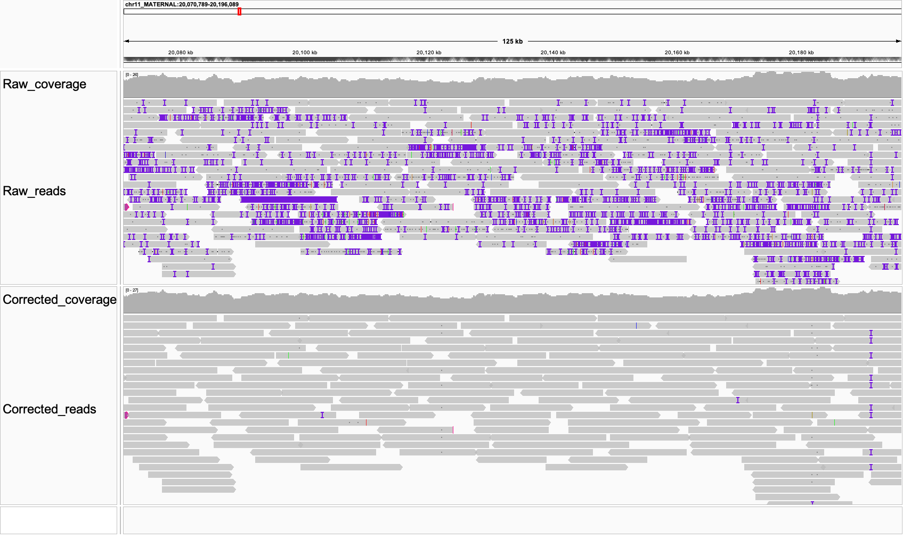

## <a name="intro"></a>Introduction

HALE (**H**aplotype-**A**ware **L**ong-read **E**rror correction) is a haplotype-aware error correction tool designed for long reads. It supports correction of both ONT Simplex and PacBio HiFi reads. The algorithm implemented in HALE builds on the Minimum Error Correction (MEC) optimization framework, commonly used in read phasing tools such as [WhatsHap](https://github.com/whatshap/whatshap). 


## <a name="requirements"></a> Dependencies
- Linux OS (tested on Ubuntu 22.04)
- [rustup](https://rustup.rs/) (See installation instructions [here](https://rustup.rs/))
- Python 3.1 or above and [conda](https://docs.conda.io/projects/conda/en/stable/user-guide/install/linux.html) for data preprocessing

  <!-- ### <a name="sys-requirements"></a> System Requirements -->
- Make sure the following system packages are installed (Linux):
  <!-- - build-essential (build-essential includes g++, make and standard headers like libc6-dev)
  - autoconf 
  - libtool 
  - pkg-config -->
  - `build-essential`, `autoconf`, `libtool`, `pkg-config`, `time`
      - To install these on Ubuntu/Debian: you can use the command: ``apt-get install build-essential autoconf libtool pkg-config time``

  Note: If you're using a Linux system, there's a good chance these system packages are already installed, especially if development tools have been previously set up.


## <a name="started"></a>Try HALE on Small Test Data
The entire test workflow below will take about 5-6 minutes. Users can either run the commands one by one or copy the commands into an executable script.

```sh
# Install HALE 
git clone https://github.com/at-cg/HALE.git
cd HALE
cargo build -q --release

# Create conda env
conda env create --file scripts/hale-env.yml
conda activate hale

mkdir -p test_run && cd test_run/

# download small test dataset
wget https://github.com/chhylp123/hifiasm/releases/download/v0.7/chr11-2M.fa.gz

# Run hale correction
../target/release/hale correct --reads chr11-2M.fa.gz --threads 8 --depth 40 --ploidy 2 --tech hifi

```

### <a name="visualize"></a>Visualize Corrections

After the above test run, users can also visualize the error reduction by aligning the raw reads and the corrected reads to [HG002 diploid genome assembly](https://s3-us-west-2.amazonaws.com/human-pangenomics/T2T/HG002/assemblies/hg002v1.1.fasta.gz). Subsequently, load the alignments (BAM) in [IGV](https://igv.org). 
<p align="left"> 


<em>Figure: Read alignments indicating the reduction in sequencing errors (colored bars) after HALE correction.</em> </p>


## <a name="install"></a>Installation

1. Clone the repository:
```sh
git clone https://github.com/at-cg/HALE.git
```

2. Compile the source code:
```sh
cd HALE
cargo build -q --release
```

3. Create conda env
```sh
conda env create --file scripts/hale-env.yml
conda activate hale
```


##  <a name="usage"></a>Usage

```shell
#Produce help page
$ /path/to/HALE/target/release/hale -h
HALE — Haplotype-Aware Long-read Error Correction

Usage:
  hale correct [OPTIONS]

Required options:
  --reads <file>        Input fastq or fastq.gz
  --threads <int>       Number of threads
  --depth <int>         Sequencing depth
  --ploidy <int>        Genome ploidy
  --tech <ont|hifi>     Sequencing technology

Example:
  hale correct \
      --reads /path/to/sample.fastq.gz \
      --threads 32 \
      --depth 60 \
      --ploidy 2 \
      --tech ont
```
**Output file :** ```hale_corrected_sample.fastq.gz``` will be created in the same directory.

Note: 
  - Flag ```--depth``` represent dataset depth (default 60x)
  - Flag```--ploidy``` represent ploidy of genome (default 2)
  - Temporary alignment files are removed automatically upon successful completion.


## Implementation Notes:
#### Automatic pipeline selection

HALE automatically selects the appropriate correction pipeline based on the sequencing technology:

- **PacBio HiFi**
  - Single round of all-vs-all overlap
  - One HALE correction step

- **ONT Simplex**
  - Three rounds of all-vs-all overlap
  - Two pre-correction rounds (`pih` mode)
  - One final correction round (`hale` mode)

No additional flags are required beyond `--tech`.


#### Other dependencies (handled via conda)

The conda environment installs:
- minimap2
- seqkit
- samtools
- Python dependencies for preprocessing


##  <a name="ack"></a>Acknowledgement

This code uses components of [HERRO](https://github.com/lbcb-sci/herro), developed by Dominik Stanojevic for preprocessing reads, e.g., computing all-vs-all read overlaps and multiple sequence alignment. 

